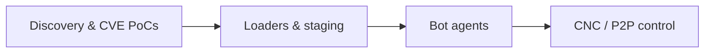

# PocBit Exploit Archive

**Archived IoT & CVE exploit PoCs, scanners, loaders, and research stacks.**  
Educational material for **authorized security research**, malware analysis, and defensive engineering—not a maintained product line.

Each top-level folder is a **standalone project** with its own build steps, dependencies, and [`README.md`](./0daylte-dahua/README.md) (37 projects total).

---

## ⚠️ Legal & ethics

| Rule | Detail |
|------|--------|
| **Permission** | Only systems you own or have **written** authorization to test |
| **Publishing** | Scrub webhooks, `.env`, `users.json`, live IPs, keys, and target lists before `git push` |
| **Intent** | Analysis, reproduction in lab, and hardening—not operational abuse |

---

## What’s in the archive

Roughly **1,900+ files** across **36** top-level trees. Dominant languages: **C** (bots/loaders), **Go** (CNC, scanners, exploits), **Python** (mass exploit scripts), plus smaller **Java/Android** and **C++** pieces.

### Layer model



| Layer | Role | Examples |
|-------|------|----------|
| **Discovery / PoC** | Fingerprint, CVE check, cred leak | `axis`, `hikvision`, `enjoysploit`, `docker`, `etcd` |
| **Loaders** | Telnet, HTTP, ADB, proprietary protocols | `scanner`, `massload`, `0daylte-dahua`, `goahead`, `adb-priv` |
| **Bots** | Flood, scanner, persistence on device | `aterna/bot`, `overbyte 3.0/bot`, `ReflectNET/bot`, `Windows/bot` |
| **Command** | Operator UI, API, DB, mesh | `overbyte 3.0/cnc`, `aterna/cnc`, `P2P`, `FoucsCnC` |

### Major families

| Family | Directories | Notes |
|--------|-------------|--------|
| **Mirai derivatives** | `private`, `lll`, `ReflectNET` | Classic bot + Go MySQL CNC + telnet `loader/src` |
| **Custom stacks** | `overbyte 3.0`, `aterna`, `Windows` | Mutual auth, Telegram, termfx UI, Windows PE bots |
| **Decentralized** | `P2P`, `peer4you` | DHT/gossip overlay + NAT relay |
| **CVE bundle** | `enjoysploit` | Gitea, XWiki, vCenter, ActiveMQ |
| **IoT megaloader** | `massload` | `meowloader.go` — many router CVEs in one binary |
| **Leaks / reconstructions** | `cc` | [Drifter report](https://github.com/deepfield/public-research/blob/main/drifter/report.md) |

---

## Quick start

This repository is **not** one unified build. Always work inside the project directory:

```bash
cd <project>/
# Read README.md there first
go build .          # or make / python3 exploit.py ...
```

**Suggested entry points for orientation:**

| If you want to… | Start here |
|-----------------|------------|
| Read a small, self-contained PoC | [`docker/`](docker/README.md), [`collabora/`](collabora/README.md) |
| Trace telnet → loader flow | [`scanner/`](scanner/README.md) |
| Study a full bot+CNC layout | [`overbyte 3.0/`](overbyte%203.0/README.md) or [`aterna/`](aterna/README.md) |
| Camera / NVR tooling | [`dvr/`](dvr/README.md), [`cam/`](cam/README.md), [`0daylte-dahua/`](0daylte-dahua/README.md) |

---

## Project index

### Scanners, exploits & mass tools

| Directory | Summary |
|-----------|---------|
| [`0daylte-dahua`](0daylte-dahua/README.md) | Dahua TCP **3001** protocol loader |
| [`adb-priv`](adb-priv/README.md) | ADB over SOCKS + optional Android app |
| [`armv7`](armv7/README.md) | JAWS camera chain + drop server |
| [`axis`](axis/README.md) | CVE-2018-10660 AXIS |
| [`boa`](boa/README.md) | Boa / embedded HTTP routers |
| [`broadband-router`](broadband-router/README.md) | Comtrend-style brute |
| [`cam`](cam/README.md) | Hikvision / Dahua / Axis / GoAhead fingerprint |
| [`cisco`](cisco/README.md) | GoAhead Cisco RV class |
| [`collabora`](collabora/README.md) | CVE-2026-110447 Collabora CODE |
| [`docker`](docker/README.md) | Unauthenticated Docker API |
| [`dvr`](dvr/README.md) | DVR/NVR multi-CVE stdin scanner |
| [`elementor`](elementor/README.md) | WordPress Elementor |
| [`enjoysploit`](enjoysploit/README.md) | Multi-CVE PoC pack |
| [`etcd`](etcd/README.md) | Open **2379** key extraction |
| [`geoscanner`](geoscanner/README.md) | CVE-2024-36401 GeoServer |
| [`goahead`](goahead/README.md) | Port **81** GoAhead loader |
| [`hikvision`](hikvision/README.md) | CVE-2021-36260 |
| [`massload`](massload/README.md) | Aggregated IoT CVE loader |
| [`plex2shell`](plex2shell/README.md) | Plex RCE framework (GPLv3) |
| [`router`](router/README.md) | Boa **0.93.15** + zmap weights |
| [`rsync`](rsync/README.md) | Open rsync modules & loot |
| [`samsung`](samsung/README.md) | Samsung IoT HTTP drop |
| [`scanner`](scanner/README.md) | Masscan → telnet brute → loader |
| [`sshhhhreal`](sshhhhreal/README.md) | SSH brute helpers |
| [`tenda_telnet`](tenda_telnet/README.md) | Tenda `/goform/telnet` |
| [`new`](new/README.md) | Python telnet loader + C bot sample |

### Botnet stacks & CNC

| Directory | Summary |
|-----------|---------|
| [`aterna`](aterna/README.md) | Bot + CNC + Telegram + file server |
| [`cc`](cc/README.md) | Drifter leak reconstruction |
| [`FoucsCnC`](FoucsCnC/README.md) | Focus CNC + scanner bot |
| [`lll`](lll/README.md) | Mirai fork |
| [`overbyte 3.0`](overbyte%203.0/README.md) | Overbyte bot + MySQL CNC |
| [`P2P`](P2P/README.md) | Mesh agent (`guardian_p2p`) |
| [`peer4you`](peer4you/README.md) | UPnP / TCP relay |
| [`private`](private/README.md) | Mirai fork (private tree) |
| [`ReflectNET`](ReflectNET/README.md) | Hardened Mirai variant |
| [`Windows`](Windows/README.md) | Windows bot + Go CNC |

---

## Repository hygiene

A root [`.gitignore`](.gitignore) excludes common secrets and build output. Before sharing or pushing:

1. Rotate or remove Discord webhooks and default CNC passwords.  
2. Delete or never add: `keys/*.sec`, `.env.cnc`, debug APKs, `.gradle` caches.  
3. Replace sample `ips.txt` with `.example` files if you need templates in git.  
4. Prefer a **private** GitHub repository for this archive.

---

## License

No unified license at the repository root. Subprojects may carry their own terms (e.g. `plex2shell` is GPLv3). Treat unmarked code as **all rights reserved / research-only** unless you add explicit licensing.
